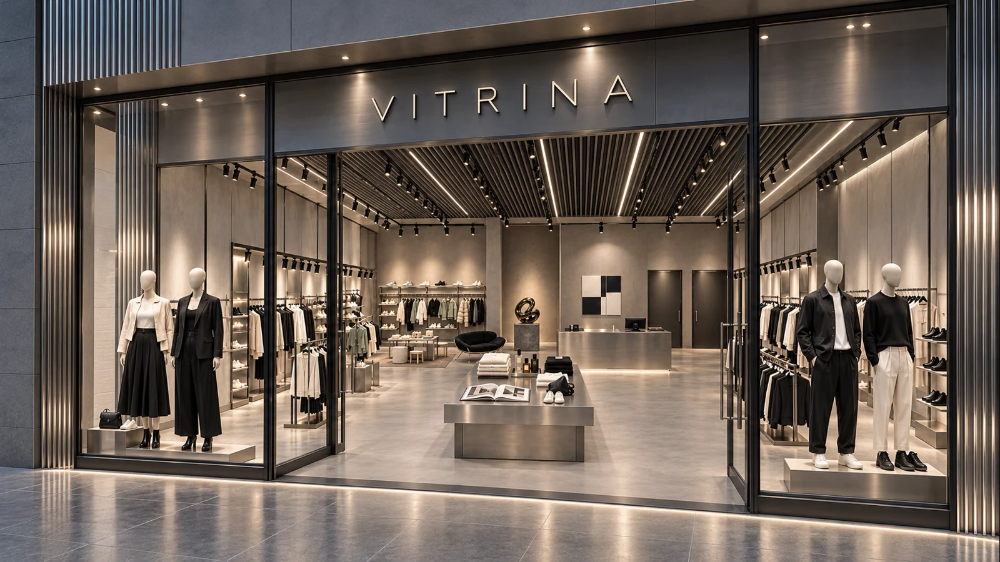

# Vidriera

**Aprender Visual Merchandising a través del espacio, el producto y la experiencia.**

Vidriera es un proyecto educativo interactivo en español para explorar cómo se diseña y se vive un local comercial. Combina un curso guiado, la exploración de una tienda virtual y un taller donde probar ideas propias.

Lo publico para acercar el conocimiento del Visual Merchandising a más personas: estudiantes, docentes, profesionales y quienes sienten curiosidad por la moda y el diseño de espacios. Quiero que este aprendizaje pueda continuar fuera del aula, al ritmo de cada persona.

[**Entrar a Vidriera →**](https://ricardo-3.github.io/vidriera/)

## De dónde nace

Soy **Ricardo Romero Medina**. Me formé en Producción de Moda, continué perfeccionándome en Argentina y trabajé durante más de diez años en diseño de interiores y locales comerciales. Más adelante estudié diseño digital y web. Vidriera nace al conectar esas experiencias con mi práctica docente.

Uno de mis objetivos es aportar a la actualización de la cátedra de Visual Merchandising de la **Escuela Argentina de Moda**, donde me formé, y compartir ese aporte con personas que están fuera de ese espacio educativo.

La idea es transformar lo aprendido en herramientas con las que se pueda observar, experimentar y tomar decisiones sobre la relación entre los productos, los espacios y las personas.



## Qué podés hacer

- **Curso VM:** recorrer once temas con explicaciones visuales, ejemplos y ejercicios sobre marca, distribución, recorrido, composición, mobiliario, producto, color, iluminación y vidrieras.
- **Explora el local:** observar las distintas zonas de una misma tienda, descubrir detalles y comparar decisiones de color e iluminación.
- **El taller:** diseñar una planta esquemática, mover zonas y muebles, dibujar recorridos y croquis, experimentar con color y composición y exportar tus propuestas.

Cada tema propone observar, entender y probar. El avance se guarda en el navegador; al terminar el recorrido de un tema, una confirmación permite continuar al siguiente. Podés volver a los temas completados y retomar tus ejercicios.

## Inspiración

Me inspira [**FREE GAME, de Virgil Abloh**](https://free-game.virgilabloh.com/), por su intención de compartir experiencia y recursos para ampliar el acceso al conocimiento creativo.

En Vidriera llevo esa intención a mi propio campo: compartir lo que aprendí en moda y espacios comerciales, y convertirlo en una experiencia educativa que pueda llegar a más personas.

## Un proyecto que sigue creciendo

Vidriera es un primer paso hacia la creación de más herramientas para aprender y experimentar con el diseño de interiores, la moda y las experiencias en los locales comerciales.

El proyecto continúa en desarrollo. Los contenidos y las imágenes están pendientes de revisión final; las transiciones de video son una etapa futura. Las actividades actuales permiten explorar y practicar con imágenes y herramientas interactivas.

## Desarrollo y documentación

El proyecto utiliza **React y Vite** y genera una web estática en `dist/`.

```sh
npm ci
npm run build
node tests/check-all.mjs
```

- [Guía técnica](docs/GUIA_TECNICA.md): estructura del código, rutas, guardados y comprobaciones.
- [Interactividad y taller](docs/INTERACTIVIDAD.md): actividades y criterios de funcionamiento.
- [Guía para continuar el desarrollo](docs/PROMPT_CONTINUIDAD.md): contexto y requisitos que deben conservarse.
- [Documento maestro](docs/Vitrina_documento_maestro_v5.txt): base de contenidos y especificación del curso.

**Creado por Ricardo Romero Medina.**
